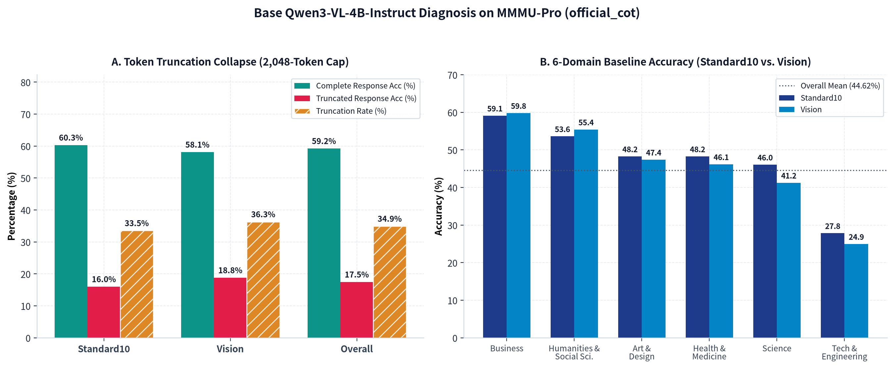
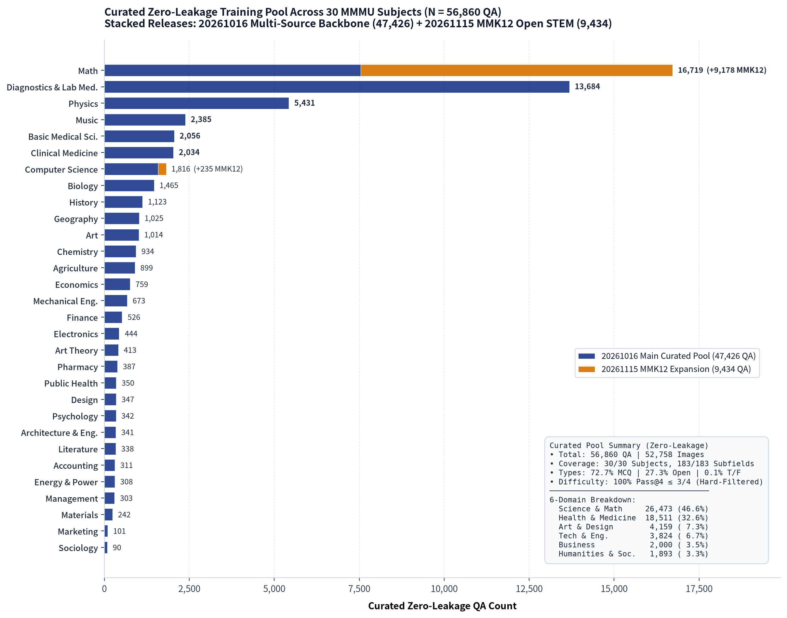
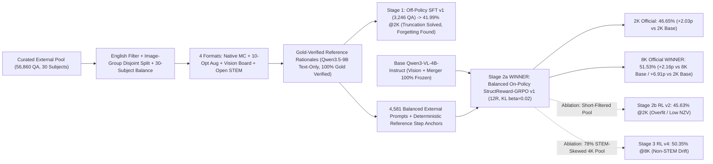
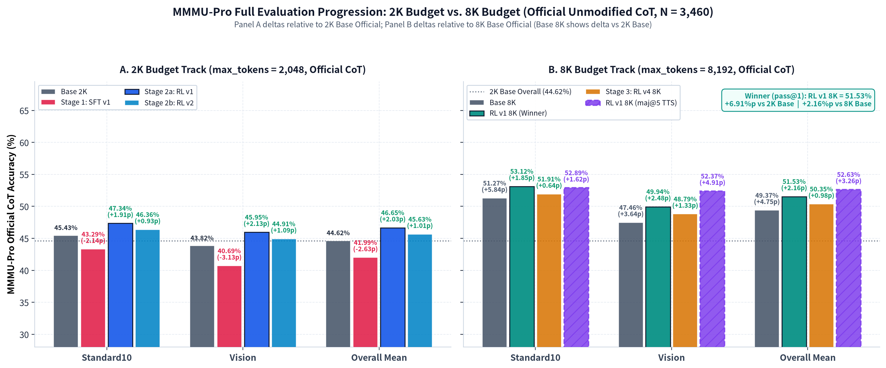
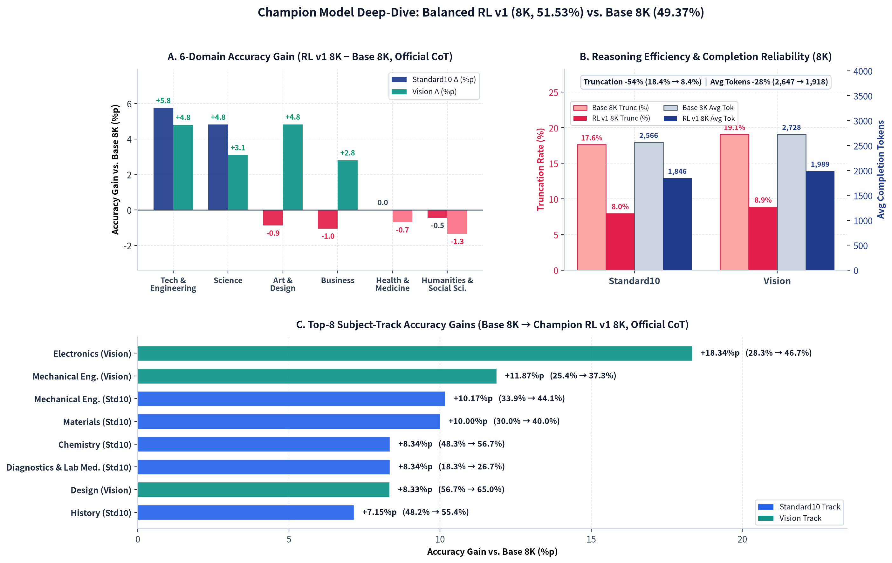
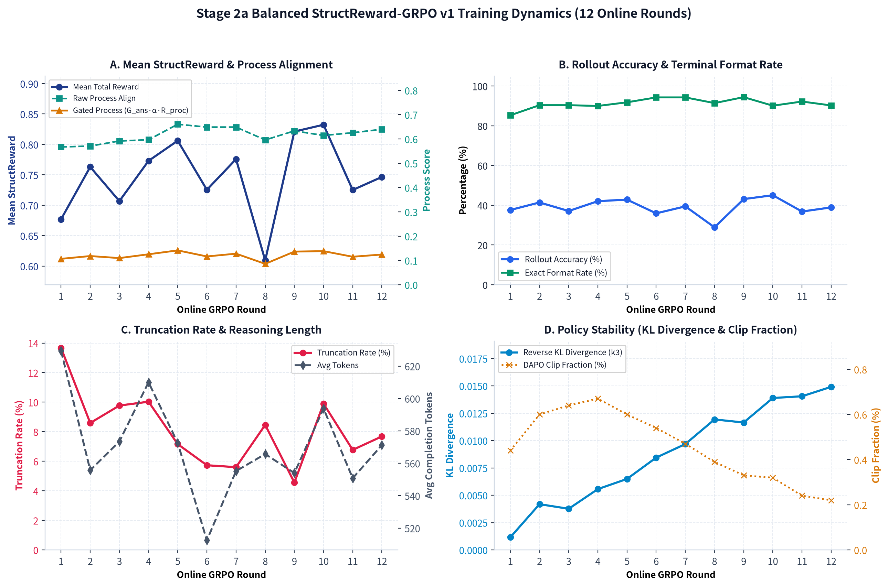

# MMMU-Pro Zero-Leakage 성능 향상 프로젝트 최종 발표 자료

> **대상 모델**: `Qwen/Qwen3-VL-4B-Instruct` (고정 리비전 `ebb281ec70b05090aa6165b016eac8ec08e71b17`)  
> **최종 우승 모델**: **Stage 2a Balanced Pure On-Policy StructReward-GRPO v1 (`eval_rl_v1_8k`)**  
> **핵심 성과**: Official pass@1 **51.53%** (Strict **51.53%**, **+6.91%p** vs 2K Base `44.62%` / **+2.16%p** vs 8K Base `49.37%`) · 8K 잘림률 **-54%** · 평균 토큰 **-28%** · **100% Zero-Leakage**

---

## Slide 1. 타이틀 및 최종 성과 요약

### Zero-Leakage On-Policy StructReward-GRPO를 통한 `Qwen3-VL-4B-Instruct`의 MMMU-Pro 성능 도약

- **프로젝트 목표**: 고정된 4B 멀티모달 백본(`Qwen/Qwen3-VL-4B-Instruct`)을 대상으로, 벤치마크 데이터 유출 없이 **MMMU-Pro Overall 정확도를 2K 베이스라인 44.62%에서 +5~10%p 향상**시키는 재현 가능한 사후학습 파이프라인 구축
- **최종 달성 성과 (3,460문항 전체 평가, 공식 `official_cot` pass@1)**:
  - **2K 예산 (`max_tokens=2048`)**: Base `44.62%` → **RL v1 `46.65%`** (**+2.03%p** 순수 가중치 향상, Stage 1 Off-Policy SFT `41.99%` 대비 **+4.66%p**)
  - **8K 예산 (`max_tokens=8192`)**: Base 8K `49.37%` → **🏆 RL v1 8K `51.53%`** (**Std10 `53.12%` / Vision `49.94%`**, **+2.16%p** vs 8K Base / **+6.91%p** vs 2K Base, Strict **`51.53%`**)
  - **추론 효율 동시 혁신**: 8K 기준 잘림률 **18.4% → 8.4% (-54% 감소)**, 평균 생성 토큰 **2,647 → 1,918 (-28% 절감)** — 더 짧고 깔끔하게 생각하면서 더 많이 맞히는 정책 학습
- **핵심 연구 여정 4단계**:
  1. **Zero-Leakage 데이터셋 큐레이션** (56,860 QA · 30과목 · 183세부분야 · 5중 오염 제거)
  2. **Stage 1 Off-Policy SFT 포렌식 진단**: 잘림 해소(+99건) vs Base 강점 과목 치명적 망각(-190건) 정량 규명
  3. **Stage 2a Balanced On-Policy StructReward-GRPO v1 🏆**: Vision+Merger 동결 + Base 직결 Reverse KL로 망각 없이 +2.03%p(2K) / +2.16%p(8K) 순수 도약
  4. **Stage 2b RL v2 & Stage 3 Hard-STEM RL v4 비교 검증**: 왜 **30과목 균형 분포 + Base 직결 단일 스테이지 RL**이 최고 일반화를 달성하는지 입증

> **발표자 노트 / Key Takeaway**: 본 프로젝트는 100% Zero-Leakage 조건에서 2K 베이스라인 44.62%를 8K Official pass@1 **51.53% (+6.91%p)**까지 끌어올리며 목표 구간(+5~10%p)을 달성했고, 동일 8K 예산 내에서도 순수 RL 가중치 효과만으로 **+2.16%p 향상 + 잘림 54% 감소 + 토큰 28% 절감**을 동시에 입증했습니다.

---

## Slide 2. 프로젝트 제약 및 베이스라인 진단

### 전체 3,460문항 2K 베이스라인 진단: "토큰 잘림 붕괴 (-41.7%p)" + "프롬프트·디코딩 단독의 한계"

| 구분 | 설정 (`max_tokens=2048`) | Standard10 (%) | Vision (%) | **Overall (%)** | 잘림률 (Std10 / Vis) | 시사점 |
|---|---|---:|---:|---:|---:|---|
| **Base (`pp=0.0`)** | `official_cot` | 43.99 *(761)* | 41.68 *(721)* | **42.84** | 37.34% / 40.23% | 반복 페널티 없을 시 38.8% 잘림·루프 심화 |
| **Base (`pp=1.5`)** *(공식 기준)* | `official_cot` | **45.43** *(786)* | **43.82** *(758)* | **44.62** | **33.53% / 36.30%** | Strict **44.48%**, 평균 1,124 / 1,189 tok |
| Base (`pp=1.5`) | `calibrated_cot` | 45.90 *(794)* | 42.72 *(739)* | 44.31 | 23.70% / 22.95% | Vision 전사 생략 시 **-1.10%p 하락** |
| Base (`pp=1.5`) | `budget_cot` | 47.86 *(828)* | 44.34 *(767)* | **46.10** | 19.54% / 21.91% | 예산 인식 프롬프트로 +1.48%p, 그러나 한계 뚜렷 |
| **완결 vs 잘림 격차** | Base `official_cot` | **60.3 vs 16.0** | **58.1 vs 18.8** | **59.2 vs 17.5** | 전체 **34.91%** 잘림 | **-41.7%p**의 극단적 잘림 붕괴 확인 |
| **선행 실패 교훈** | 나이브 69토큰 / 단답 강제 SFT | — | — | **-6.4%p / 25.8%** | — | 과도한 단문·단답 압축은 CoT 추론력을 파괴 |

- **핵심 진단 3가지**:
  1. **잘림 붕괴 (-41.7%p)**: 추론이 완결되면 **59.2%**에 달하지만, 장황한 반복·과잉 의심으로 **34.9%**가 2,048토큰에서 잘려 **17.5%**로 추락한다.
  2. **디코딩·프롬프트 단독 튜닝의 상한**: `pp=1.5`(+1.78%p)와 `budget_cot`(+1.48%p)는 보조 효과가 있으나 +5~10%p 도약에는 역부족이며, Vision에서 문항 전사를 빼면 오히려 정확도가 하락한다.
  3. **취약 도메인 집중**: Base Official CoT 기준 **Tech & Engineering (`27.82% / 24.94%`)**, **Science (`46.05% / 41.24%`)**, **Diagnostics (`20.0% / 26.7%`)**, **Music (`18.3% / 30.0%`)**이 핵심 개선 대상이다.

> **발표자 노트 / Key Takeaway**: 2K 베이스라인 3,460문항 진단으로 "완결 시 59.2% vs 잘림 시 17.5%"라는 거대한 손실원과 "프롬프트·디코딩만으로는 한계가 뚜렷하다"는 두 가지 사실을 정량 확증했습니다.

---

## Slide 3. Zero-Leakage 데이터셋 구축 ① — 다중 원천 라우팅 및 구축 진화

### 벤치마크 완전 격리(Zero-Leakage)와 도메인 편향 차단 설계

- **4대 절대 원칙**:
  1. **Zero-Leakage**: `MMMU` (`dev`, `validation`, `test`) 및 `MMMU-Pro` (`Standard-4/10`, `Vision`)의 문제·선택지·이미지·정답 일체 미사용 (오직 **30개 과목명·183개 세부분야 taxonomy 정의**만 참조)
  2. **No Synthetic Authoring**: 임의 문항 창작 금지, 공개 학술 데이터셋의 원본 QA·이미지 바이트 보존
  3. **Fail-Closed 파이프라인**: 7단계 게이트 중 증빙 메타데이터가 하나라도 누락되면 즉시 탈락
  4. **완전한 재현성**: 43개 원천 데이터셋 커밋 리비전(`SOURCES.csv`) 및 전체 `SHA256SUMS` 기록

| 구축 단계 | 시점 | 규모 및 목표 | 핵심 성과 |
|---|---|---|---|
| **1~2단계** | 2026-09 ~ 10-01 | 30과목 × 다중 원천 라우팅 + Pass@4 도입 | 단일 수학 편향 제거, 타겟 모델 약점 중심 수집 |
| **3단계 (기본 풀)** | 2026-10-16 | `mmmu_train_20261016` 확정 | **47,426 QA**, 43,335 이미지, 183/183 세부분야 대표 확보 |
| **4단계 (STEM 확장)** | 2026-11-15 | `mmmu_expansion_mmk12_20261115` 추가 | **+9,434 QA** (`FanqingM/MMK12` Apache-2.0, 서술형 수학·CS) |
| **최종 통합 풀** | **2026-11** | **56,860 QA / 52,758 이미지** | **ID 중복 0건**, 43개 공개 학술 원천 통합 |

- **공통 백본 + 6대 분야 전용 보강 라우팅**:
  - **공통 백본**: `BMMR` (8,236), `CulturalGround` (2,728), `FineVision` 4대 지표 ≥ 4점 (870), `MMFineReason` 중 `BMMR` 검증분만 선별 (430)
  - **6대 전용 원천**: Health (`PMC-VQA` 19,797) · Science (`ArxivQA` 9,878, `MMK12` 9,434, `AgroBench` 325) · Art (`MusiXQA` 2,224, `AesMMIT` 257) · Business (`ChartQA` 1,342, `TAT-HQA/DQA`, `HiTab`) · Humanities (`PersonaVLM`, `QuAIL`, `RACE`)
  - **의도적 배제**: 오염 위험·품질 편차가 큰 `VisualWebInstruct`, `LLaVA-CoT` 배정량 **0 고정**

> **발표자 노트 / Key Takeaway**: 수학 데이터에만 80% 편중된 기성 데이터셋을 피하고 6대 학문 영역별로 43개 학술 원천을 정밀 라우팅했으며, 오염 우려 원천은 설계 단계부터 배제했습니다.

---

## Slide 4. Zero-Leakage 데이터셋 구축 ② — 7단계 Fail-Closed 게이트 & 5중 오염 제거

### 텍스트·OCR·지각 해시·CLIP 임베딩까지 5중 오염 차단

| Gate | 검증 단계 | 핵심 알고리즘 및 통과 기준 (Fail-Closed) |
|---|---|---|
| **Gate 1** | **5중 멀티모달 오염 제거** | `MMMU (dev/val/test)` + `MMMU-Pro` 전체 대상 아래 5개 조건 **모두** 통과 |
| **Gate 2** | **Pass@4 난이도 필터링** | 타겟 모델 4회 추론(`T=0.7, top_p=0.8, top_k=20`) 후 **4/4 정답 전면 제외** (`0/4~3/4`만 채택) |
| **Gate 3** | **이중 독립 분류기 합의** | `Qwen3-VL-4B-Instruct` (V+T) & `Qwen3-1.7B` (T) 동일 과목 합의 & **양쪽 confidence ≥ 0.85** |
| **Gate 4** | **시각 의존성 검증** | 이미지 없이 텍스트만으로 풀리는 문항(text-only solvable) 배제 |
| **Gate 5** | **전역 이미지 중복 상한** | BK-Tree 64-bit DCT pHash 클러스터링(Hamming ≤ 6), **동일 이미지 그룹당 최대 2 QA** |
| **Gate 6** | **정답·형식 정합성** | 2~26지선다 기호-범위 일치 검증, 충돌 문항 영구 제외 레지스트리(`source_qa_exclusions.json`) |
| **Gate 7** | **라이선스·프로비넌스** | 43개 원천 개별 라이선스 추적 (NC 포함 원천은 내부 연구·평가 전용, 외부 재배포 금지) |

#### Gate 1. 5중 오염 차단 상세 기준

| 검사 축 | 알고리즘 / 구현 | 차단 임계값 (통과 조건) |
|---|---|---|
| **텍스트 완전 일치** | NFKC + casefold + 공백 정규화 (`question + options`) | `exact_match == False` |
| **텍스트 유사 중복** | 5-gram 문자 shingle, 128-perm MinHash LSH (32×4) | `minhash_jaccard_max < 0.80` |
| **이미지 내 OCR** | 이미지 OCR 추출 텍스트의 13-word-gram 집합 매칭 | `ocr_13gram_match == False` |
| **이미지 지각 해시** | 32×32 grayscale 2D-DCT 상위 8×8 기반 64-bit pHash | `phash_hamming_min > 6` |
| **이미지 의미 임베딩** | CLIP ViT-B/32 정규화 벡터 코사인 유사도 | `embedding_cosine_max < 0.97` |

- **MMK12 서술형 정밀 채점**: 규칙 파서 1차 판정 후 미판정 응답은 `Qwen/Qwen3.8-27B` semantic judge (`confidence ≥ 0.9`, `quality_issue == False`)로 재검수

> **발표자 노트 / Key Takeaway**: 단순 텍스트 매칭만으로는 MMMU-Pro Vision 트랙의 이미지 중복을 막을 수 없습니다. OCR 13-gram, 64-bit pHash, CLIP 임베딩까지 5중 방어선으로 Zero-Leakage를 정량 보장했습니다.

---

## Slide 5. Zero-Leakage 데이터셋 구축 ③ — 30과목 분포 및 MMMU-Pro 전이 전처리

### 56,860 QA 정량 현황과 10지선다·Vision 보드 격차 해소

- **최종 통합 풀 정량 요약 (`56,860 QA`)**:
  - **문항 유형**: 객관식 **41,312건** (72.7%) · 서술/단답형 **15,517건** (27.3%) · 진위형 **31건** (0.1%)
  - **커버리지**: **30/30 과목**, **183/183 세부분야** 대표 확보 (**140/183 ≥ 100건**), 다중 이미지 **499건**
  - **내장 풀이(Rationale)**: **18,167건** (`ArxivQA` 9,867 · `BMMR` 8,293 · `CoSyn` 7, 중앙값 362자)
  - **난이도 구성**: `0/4` 48,606건 (85.5%) · `1/4~3/4` 8,254건 (14.5%)
- **MMMU-Pro 전이를 위한 4가지 핵심 전처리 (`prepare_training_pools.py`)**:
  1. **영어 전용 필터링**: CJK 포함 문항·풀이 제거 → 영어 MMMU-Pro 평가 시 중국어 추론 드리프트 차단
  2. **이미지 그룹 완전 분리**: `image_phash_group` 단위로 **SFT / RL / ExtDev 100% 비중복 분할** + **30과목 균형 샘플링** (Math·Diagnostics 53.5% 편중 완화 — 최종 우승의 결정적 요인!)
  3. **10지선다 외부 오답 확장 (`standard10_aug`)**: 기존 4지선다(94.4%) 한계를 극복하기 위해 동일 과목·유사 길이의 외부 오답으로 10지선다 구성 후 **정답 위치를 A~J 균등 셔플**
  4. **합성 Vision 보드 렌더링 (`vision_board`)**: 외부 문항·원본 이미지·선택지를 960px 시험지 이미지로 렌더링해 MMMU-Pro Vision 트랙으로 직접 전이

> **발표자 노트 / Key Takeaway**: 이후 Stage 3 Hard-STEM RL v4 실험에서 증명되었듯, 30개 과목 균형 샘플링은 단순한 전처리 옵션이 아니라 비-STEM 도메인 드리프트를 막고 최고 일반화(51.53%)를 끌어낸 핵심 설계였습니다.

---

## Slide 6. 전체 실험 아키텍처 및 데이터 기반 피벗 여정

### 가설 검증 → 포렌식 분해 → Base 직결 On-Policy RL 우승 → 8K 추론 확장

- **전체 4개 학습 실험을 관통하는 핵심 인과관계**:
  1. **Stage 1 Off-Policy SFT (`41.99% @2K`)**: 잘림은 잡았으나 Base 강점 과목 망각(-190건)과 `visual.merger` 드리프트 노출 → **Base 직결 On-Policy RL 피벗**의 근거 확보
  2. **Stage 2a Balanced On-Policy StructReward-GRPO v1 🏆 (`46.65% @2K` / `51.53% @8K`)**: Vision+Merger 동결 + Base 직결 Reverse KL + 30과목 균형 풀로 **2K·8K 모두에서 압도적 1위 달성**
  3. **Stage 2b Short-Filtered RL v2 (`45.63% @2K`)**: 짧고 쉬운 검증 풀만 남기자 `nzv_groups` 다양성 감소·과적합으로 RL v1 대비 -1.02%p 하락
  4. **Stage 3 4K Hard-STEM RL v4 (`50.35% @8K`)**: 78% STEM 편중 풀로 2차 RL을 돌리자 Art & Design / Health에서 비-STEM 드리프트가 발생해 RL v1 대비 -1.18%p 하락

> **발표자 노트 / Key Takeaway**: 네 단계의 체계적인 실험(SFT v1 → RL v1 → RL v2 → RL v4)과 2K/8K 이중 평가를 통해, "왜 단일 스테이지 30과목 균형 On-Policy StructReward-GRPO(RL v1)가 최적 해법인가"를 반증 실험까지 포함해 완벽히 입증했습니다.

---

## Slide 7. Stage 1: Off-Policy Concise-CoT SFT 실증 및 포렌식 분해

### 잘림 해소(+99건) vs 치명적 망각(-190건)의 정량 규명

- **Stage 1 학습 설정 (`eval_sft_v1`)**:
  - **데이터**: 30/30 전 과목 **3,246건 Gold-Verified 외부 QA** (`standard_mc` 1,236 · `standard10_aug` 784 · `vision_board` 599 · `open` 627), 중앙값 **271단어 (~360토큰)**
  - **풀이 생성**: 오프라인 텍스트 전용 `Qwen3.5-9B` 생성(Zero logit distillation), **원본 출판사 정답 100% 일치** 건만 엄격 채택
  - **최적화**: BF16 LoRA `r=32, alpha=64`, `official_cot` 50% + `calibrated_cot` 50%, Assistant-only loss masking, LR `3e-5`, 1 epoch
- **2K 전체 MMMU-Pro 실증 (`3,460문항 × 2 프로필`)**:
  - `official_cot`: Standard10 **43.29%** (trunc **12.37%**, 660 tok) · Vision **40.69%** (trunc **12.72%**, 773 tok) · Overall **41.99%** (**-2.63%p** vs Base 44.62%)
  - `calibrated_cot`: Standard10 **43.82%** (trunc **9.71%**, 629 tok) · Vision **38.09%** (trunc **8.32%**, 716 tok) · Overall **40.95%**

#### 핵심 포렌식 분해: Base `official_cot` vs Stage 1 SFT `official_cot` (2K)

| 문항 부분집합 (Base `official_cot` 기준) | 트랙 (문항 수) | Base (%) | Stage 1 SFT (%) | 변화 (%p) | 순증감 (문항) | 규명된 원인 |
|---|---|---:|---:|---:|---:|---|
| **Base-Truncated** *(2,048토큰 잘림, 1,208건)* | Standard10 (580) | 16.0 | **25.3** | **+9.3%p** | **+54** | 간결 추론 정착으로 대폭 회복 |
| **Base-Truncated** *(2,048토큰 잘림, 1,208건)* | Vision (628) | 18.8 | **26.0** | **+7.2%p** | **+45** | 잘림률 36.3%→12.7% 급감 효과 |
| **Base-Complete** *(완결 응답, 2,252건)* | Standard10 (1,150) | **60.3** | 52.3 | **-8.0%p** | **-91** | **Off-Policy 망각** (Pharmacy·Public Health·Econ·Math) |
| **Base-Complete** *(완결 응답, 2,252건)* | Vision (1,102) | **58.1** | 49.1 | **-9.0%p** | **-99** | **Off-Policy 망각 + `visual.merger` 드리프트** |

- **최취약 도메인에서는 외부 데이터의 강한 전이 입증**: Tech & Engineering `27.82% → 34.53% (+6.71%p, cal)` / `24.94% → 29.98% (+5.04%p, Vis)`, Mechanical Eng `(+11.9~15.3%p)`, Electronics `(+13.3%p)`, Music `(+10.0%p)`

> **발표자 노트 / Key Takeaway**: Stage 1 SFT는 잘림 문제(+99건)와 최약점 공학 도메인(+6.7%p)은 확실히 개선했으나, Off-Policy 모방에 따른 강점 망각(-190건)과 `visual.merger` 드리프트가 전체 -2.63%p 하락의 정확한 원인이었습니다. 이 진단이 우승 모델 RL v1의 5대 설계 원칙으로 직결되었습니다.

---

## Slide 8. Stage 2a 우승 모델 🏆: Base 직결 Pure On-Policy StructReward-GRPO v1

### 망각 원천 차단(Vision·Merger 동결 + Base 직결 KL) + 결정론적 StructReward 최적화

- **Stage 1 포렌식 진단을 반영한 5대 핵심 설계 (`rl_structreward_v1`)**:
  1. **Base 직결 Pure On-Policy RL (`SFT 생략`)**: Off-Policy 교사 모방 망각 제거 — Base 정책 자신이 생성한 정답 롤아웃만 강화
  2. **Vision Encoder + `visual.merger` 100% 동결**: 시각 표현 드리프트를 원천 차단하고 **Language-only LoRA (`r=32, alpha=64`)**만 업데이트
  3. **Base 직결 Reverse KL ($\beta=0.02$)**: `model.disable_adapter()`로 추가 VRAM 0 상태에서 **원본 Base 정책에 직접 Schulman $k_3$ 비음수 KL 앵커링** → Base-Complete 지식 보호
  4. **30과목 균형 Gold-Verified 외부 풀**: **4,581개 고유 외부 프롬프트** + 결정론적 `reference_steps` 앵커 (전 30과목 균등 커버)
  5. **공식 프롬프트 중심 온라인 롤아웃**: **12 라운드 × 96 프롬프트 × $G=8$ = 9,216 롤아웃**, `max_tokens=1600`, **`official_cot` 80% / `calibrated_cot` 20%**

$$R(y) = G_{\text{ans}}(y)\cdot\Big(1.0 + \alpha \cdot R_{\text{process}}(y, \mathcal{S}_{\text{ref}})\Big) + R_{\text{format}}(y) + R_{\text{consistency}}(y) - R_{\text{length}}(y)$$

| 보상 항 / RL 기법 | 수식 및 설정값 | 역할 및 해킹 방지 메커니즘 |
|---|---|---|
| **정답 게이트 $G_{\text{ans}}(y)$** | $\{0.0,\; 1.0\}$ (엄격 파서, 랜덤 폴백 금지) | 오답 롤아웃의 프로세스 보상을 **0으로 차단** (Partial-Step Reward Hacking 방지) |
| **프로세스 정렬 $\alpha R_{\text{process}}$** | $\alpha=0.50$, $R_{\text{process}} \in [0, 1]$ | 참조 스텝 $\mathcal{S}_{\text{ref}}$와 **단조(monotonic)** 정렬 (수치 65% + 도메인 키워드 35%, 550단어 초과 감쇠) |
| **형식·일관성 보상** | $R_{\text{format}} \le +0.25$, $R_{\text{consistency}} \in \{-0.15, +0.15\}$ | `<think>` 태그 없이 자연스러운 다단계 사고 + 끝단 선택지 모순(`option D ... Answer: E`) 교정 |
| **길이 페널티 $R_{\text{length}}$** | 잘림 시 $0.30$; $900$토큰 초과 선형 페널티 (최대 $0.20$) | 무한 반복·과잉 의심 억제 → **2K뿐 아니라 8K 추론에서도 토큰 28% 절감 + 잘림 54% 감소** |
| **Dr.GRPO + DAPO Clip** | $\hat{A}_i = \text{clip}((R_i-\bar{R})/\max(\sigma_R,0.25), -3, 3)$, $\epsilon \in [0.20, 0.28]$ | 분산 0 그룹 동적 필터링 + 비대칭 클리핑으로 12라운드 초안정 수렴 (`KL 0.0012→0.0149`) |

> **발표자 노트 / Key Takeaway**: StructReward의 핵심은 외부 LLM Judge 없이도 "정답을 맞힌 롤아웃에 한해 참조 스텝 정렬 보상($\alpha R_{\text{process}}$)을 지급"하는 결정론적 게이트입니다. 덕분에 2K에서 학습한 간결·완결 정책이 8K 추론 예산에서도 그대로 증폭되어 51.53%라는 최고 성적을 냈습니다.

---

## Slide 9. 디코딩·프롬프트 보정 및 2K → 8K 추론 예산 확장 분석

### 디코딩(`pp`), 프롬프트 프로필, 토큰 예산(`2K → 8K`)의 직교적 효과 분해

| 실험 축 | 비교 조건 (3,460문항 전체) | Standard10 (%) | Vision (%) | **Overall (%)** | Δ (%p) | 핵심 실증 교훈 |
|---|---|---:|---:|---:|---:|---|
| **디코딩 보정 (Base 2K)** | `pp=0.0` → `pp=1.5` (`official_cot`) | 43.99 → 45.43 | 41.68 → 43.82 | 42.84 → **44.62** | **+1.78%p** | 반복 루프 억제로 잘림 `-3.8~3.9%p` 개선 |
| **디코딩 보정 (RL v1 2K)** | `pp=0.0` → `pp=1.5` (`official_cot`) | 46.36 → 47.34 | 44.80 → 45.95 | 45.58 → **46.65** | **+1.07%p** | RL v1은 `pp=0.0`에서도 Base `pp=0.0` 대비 **+2.74%p** 우위 |
| **프롬프트 보정 (Base 2K)** | `official` → `calibrated` → `budget_cot` | 45.43 → 45.90 → **47.86** | 43.82 → 42.72 → **44.34** | 44.62 → 44.31 → **46.10** | **+1.48%p** | Vision 전사 생략(`calibrated`)은 `-1.10%p`; 전사 유지(`budget_cot`)가 핵심 |
| **프롬프트 보정 (RL v1 2K)** | `official` → `calibrated` → `budget_cot` | 47.34 → 47.80 → **48.44** | **45.95** → 44.10 → 44.22 | **46.65** → 45.95 → 46.33 | Std10 **+1.10%p** | RL v1은 `official_cot` 자체로 이미 최적화 (Vision `45.95%` 최고) |
| **8K 프롬프트 (Base 8K)** | `official_cot` → `deep_verify_cot` | 51.27 → 50.92 | 47.46 → **48.96** | 49.37 → **49.94** | +0.57%p | 8K에서는 Base에 심층 검증 지시가 Vision에 소폭 도움 |
| **8K 프롬프트 (RL v1 8K)** | **`official_cot`** vs `deep_verify_cot` | **53.12** vs 52.83 | **49.94** vs 48.84 | **51.53** vs 50.84 | **`official` +0.69%p** | **RL v1은 무수정 공식 `official_cot`에서 최고점 (`51.53%`) 달성!** |
| **예산 확장 (`2K → 8K`)** | Base (`44.62 → 49.37`) vs **RL v1 (`46.65 → 51.53`)** | +5.84 vs **+5.78** | +3.64 vs **+3.99** | +4.75 vs **+4.88** | **+4.88%p** | RL v1의 순수 가중치 이득은 2K(`+2.03%p`)보다 8K(`+2.16%p`)에서 오히려 확대 |

- **공정 비교 원칙 (Strict Fairness Protocol)**:
  - 모든 체크포인트를 단일 `eval_mmmu_pro.py` (SGLang BF16, 결정론적 시드, 공식 파서, `strict_accuracy` 공개)로 평가하여 **가중치 학습 이득**, **디코딩 보정(`pp=1.5`)**, **추론 예산 확장(`2K → 8K`)**의 기여분을 완전히 분리 보고한다.

> **발표자 노트 / Key Takeaway**: RL v1의 가장 인상적인 특징은 특정 커스텀 프롬프트에 의존하지 않고 **아무것도 건드리지 않은 공식 `official_cot`에서 2K(`46.65%`)와 8K(`51.53%`) 모두 최고점을 기록**했다는 점입니다.

---

## Slide 10. 실험 결과 ① — 2K vs 8K 전체 Ablation 마스터 비교

### 전 단계 정량 비교 (Official Unmodified CoT, `pp=1.5`, N = 3,460)

| 예산 트랙 | 모델 / 학습 단계 | Standard10 (%) | Vision (%) | **Overall (%)** | Strict (%) | Δ vs 2K Base | Δ vs 동일 예산 Base | 잘림률 (Std10 / Vis) | 평균 토큰 (Std10 / Vis) |
|---|---|---:|---:|---:|---:|---:|---:|---:|---:|
| **2K** | Base `Qwen3-VL-4B-Instruct` | 45.43 *(786)* | 43.82 *(758)* | **44.62** | 44.48 | 0.00 | 0.00 | 33.53% / 36.30% | 1,124 / 1,189 |
| **2K** | Stage 1: Off-Policy SFT v1 | 43.29 *(749)* | 40.69 *(704)* | 41.99 | 41.94 | -2.63%p | -2.63%p | 12.37% / 12.72% | 660 / 773 |
| **2K** | **Stage 2a: Balanced RL v1 🏆 (2K)** | **47.34** *(819)* | **45.95** *(795)* | **46.65** | **46.48** | **+2.03%p** | **+2.03%p** | 23.93% / 26.30% | 985 / 1,057 |
| **2K** | Stage 2b: Short-Filtered RL v2 | 46.36 *(802)* | 44.91 *(777)* | 45.63 | 45.49 | +1.01%p | +1.01%p | 23.58% / 25.38% | 976 / 1,026 |
| **8K** | Base `Qwen3-VL-4B-Instruct` (8K) | 51.27 *(887)* | 47.46 *(821)* | **49.37** | 49.37 | +4.75%p | 0.00 | 17.63% / 19.08% | 2,566 / 2,728 |
| **8K** | **Stage 2a: Balanced RL v1 (8K) 🏆** | **53.12** *(919)* | **49.94** *(864)* | **51.53** | **51.53** | **+6.91%p** | **+2.16%p** | **7.98% / 8.90%** | **1,846 / 1,989** |
| **8K** | Stage 3: 4K Hard-STEM RL v4 (8K) | 51.91 *(898)* | 48.79 *(844)* | 50.35 | 50.35 | +5.73%p | +0.98%p | 7.75% / 8.73% | 1,800 / 1,968 |
| **8K (TTS)** | **RL v1 (8K) + Self-Consistency (`maj@5`)** | 52.89 *(915)* | **52.37** *(906)* | **52.63** | 51.77 | **+8.01%p** | **+3.26%p** | **3.47% / 3.47%** | 5× (`pass@5`: 65.2% / 69.3%) |

- **왜 Balanced 30-subject RL v1 (`51.53%`)이 후속 실험 `RL v2` · `RL v4`를 모두 앞섰는가?**
  - **vs Stage 2b Short-Filtered RL v2 (`45.63% @2K`, -1.02%p)**: 짧고 쉬운 verified 풀로 과도하게 필터링하자 학습 중 `nzv_groups` 다양성이 줄고 `calibrated_cot` Std10(`48.44%`)에 국소 과적합되어 `official_cot` 일반화가 저하되었다.
  - **vs Stage 3 Hard-STEM RL v4 (`50.35% @8K`, -1.18%p)**: 78% STEM 편중 Hard-STEM 풀에서 2차 RL을 진행하자 **`Art & Design` (`52.2/49.1 → 49.1/44.3`)** 및 **`Health & Medicine` (`48.6/43.7 → 45.8/42.3`)**에서 비-STEM 드리프트가 발생했다 (`Base-Complete -41/-18`, `Base-Trunc +52/+41`).
  - **핵심 교훈**: **전 30개 과목 균형 분포 + Base 직결 단일 스테이지 On-Policy KL 제약**이 가장 높은 멀티도메인 일반화를 달성한다!

> **발표자 노트 / Key Takeaway**: RL v1 8K는 랜덤 폴백 의존도가 사실상 0인 Strict `51.53%`로, 2K Base 대비 **+6.91%p**, 8K Base 대비 **+2.16%p**를 기록하며 모든 비교군(SFT v1, RL v2, RL v4)을 제치고 최종 우승했습니다.

---

## Slide 11. 실험 결과 ② — 8K 포렌식 분해 및 6대 도메인·과목별 도약

### 8K Official CoT 포렌식 분해 (`eval_rl_v1_8k` vs `eval_base_8k`)

| 트랙 | Base-Complete (8K 완결) 변화 | **Base-Truncated (8K 잘림) 회복** | 최종 순증감 | 핵심 해석 |
|---|---|---|---|---|
| **Standard10** *(1,730)* | 1,425건: `848 → 816` (`-32`, `-2.25%p`) | **305건: `39 → 103` (`+64`, `+20.98%p`)** | **+32건 (+1.85%p)** | 잘림 회복(+64)이 소폭 손실(-32)을 2배 압도 |
| **Vision** *(1,730)* | 1,400건: `764 → 755` (`-9`, **`-0.64%p`**) | **330건: `57 → 109` (`+52`, `+15.76%p`)** | **+43건 (+2.48%p)** | **Vision 완결 문항 사실상 망각 0!** (Vision+Merger 동결 입증) |
| **전체 합계** *(3,460)* | 2,825건: `1,612 → 1,571` (`-41`, `-1.45%p`) | **635건: `96 → 212` (`+116`, `+18.27%p`)** | **+75건 (+2.16%p)** | Stage 1 SFT(`-190/+99`)의 비대칭을 **완전히 역전(`-41/+116`)!** |

### 6대 도메인별 8K Official CoT 비교 (`Base 8K` → `RL v1 8K 🏆` vs `RL v4 8K`)

| MMMU-Pro 대분류 | Base 8K (Std10 / Vis) | **RL v1 8K 🏆 (Std10 / Vis)** | **Δ (RL v1 − Base 8K)** | RL v4 8K (Std10 / Vis) | 주요 도약 과목 (RL v1 vs Base 8K) |
|---|---:|---:|---:|---:|---|
| **Tech & Engineering** | 38.37 / 34.53 *(36.45)* | **44.12 / 39.33 *(41.73)*** | **+5.28%p** | 42.69 / 37.89 *(40.29)* | **Electronics Vis +18.3p**, **MechEng Vis +11.9p / Std +10.2p**, **Materials +10.0p** |
| **Science** | 48.80 / 45.02 *(46.91)* | **53.61 / 48.11 *(50.86)*** | **+3.95%p** | 52.23 / 48.11 *(50.17)* | **Chemistry Std +8.3p / Vis +5.0p**, **Biology +6.8p**, **Math +6.7p**, **Geo Vis +5.8p** |
| **Art & Design** | 53.07 / 44.30 *(48.69)* | **52.19 / 49.12 *(50.66)*** | **+1.97%p** | 49.12 / 44.30 *(46.71)* | **Design Vis +8.3p**, **Art Theory +5.5p/+5.5p** *(RL v4는 -1.98p 드리프트)* |
| **Business** | 71.33 / 69.23 *(70.28)* | **70.28 / 72.03 *(71.16)*** | **+0.88%p** | 71.33 / 71.68 *(71.51)* | **Accounting Vis +3.4p**, **Economics Vis +3.4p**, **Finance +3.3p/+3.3p** |
| **Health & Medicine** | 48.60 / 44.41 *(46.51)* | **48.60 / 43.71 *(46.16)*** | -0.35%p | 45.80 / 42.31 *(44.06)* | **Diagnostics Std +8.3p**, **Basic Med Vis +5.8p** *(RL v4는 -2.45p 드리프트)* |
| **Humanities & Social** | 54.50 / 54.05 *(54.28)* | **54.05 / 52.70 *(53.38)*** | -0.90%p | 54.50 / 53.60 *(54.05)* | **History Std +7.2p**, 전체 강점 안정 보존 |

> **발표자 노트 / Key Takeaway**: Stage 1 SFT가 `-190건 망각 / +99건 회복`으로 순손실이었던 반면, 우승 모델 RL v1 8K는 **`-41건 / +116건 회복`으로 비대칭을 완전히 뒤집었습니다**. 특히 Vision 완결 문항의 망각은 단 9건(`-0.64%p`)으로 사실상 0에 수렴합니다.

---

## Slide 12. 실험 결과 ③ — StructReward-GRPO 학습 동학 비교

### Stage 2a Balanced RL v1 (12R, 30과목 균형) vs Stage 3 Hard-STEM RL v4 (8R, 78% STEM)

| 학습 동학 지표 | **Stage 2a Balanced RL v1 🏆 (12R, Base 직결)** | Stage 3 Hard-STEM RL v4 (8R, RL v1 이어서) | 시사점 |
|---|---|---|---|
| **프롬프트 분포** | 30개 전 과목 균형 **4,581건** | 78% STEM 편중 고난도 풀 | 균형 풀이 비-STEM 드리프트 원천 방지 |
| **활성 그룹 (`nzv_groups`)** | **78~88 / 96** (높은 학습 신호 밀도) | 70~76 / 96 (all-wrong 그룹 45~53/96) | 과도한 고난도 편중 시 Zero-Variance 증가 |
| **Mean Reward / Rollout Acc** | `0.677 → 0.832` (R10) / **`37.63% → 45.05%`** | `0.658 → 0.611` / `29.82% → 26.56%` | RL v1에서 보상·정답률·프로세스 정렬 동반 상승 |
| **Process Align (`process_raw`)** | **`0.567 → 0.661`** (R05 피크, R12 `0.640`) | `0.217 → 0.263` | 참조 스텝 정합성이 RL v1에서 훨씬 선명하게 학습 |
| **Format / Truncation (롤아웃)** | Format `85.3% → 94.4%` · Trunc **`13.7% → 4.6%`** | Format `95.3~99.4%` · Trunc `0.7~4.4%` | RL v1만으로 형식 준수 및 완결성 이미 포화 수준 도달 |
| **Reverse KL (`kl_div`)** | **`0.0012 → 0.0149`** (매끄러운 단조 수렴) | `0.0008 → 0.0021` (R3 일시 스파이크 0.049) | RL v1의 Base 직결 KL 제어가 가장 안정적 |

> **발표자 노트 / Key Takeaway**: RL v1의 12라운드 학습 곡선(`fig4`)은 Mean Reward, Process Alignment, Format Rate 상승과 Truncation 급감, 그리고 KL 0.0149 수렴이 모두 교과서적으로 맞물려 있습니다. 반면 RL v4는 78% STEM 편중과 높은 all-wrong 비율(45~53/96)로 인해 추가 이득 없이 비-STEM 드리프트만 유발했습니다.

---

## Slide 13. 정성적 분석 — 8K 실제 Before / After 사례 4건

### 무한루프·과잉사고·그래프 의심을 해소하고 10.9×~21.9× 토큰 절감과 정답 도출 동시 달성

| 문항 ID (트랙 · 과목 · 정답) | Before: Base 8K (`official_cot`) | After: Champion RL v1 8K (`official_cot`) | 토큰 절감 / 개선 유형 |
|---|---|---|---|
| **`test_Accounting_129`** *(Vision · Accounting · Gold: `F`)* | **8,192 tokens (`finish=length`, 오답)** — 합병 주당가치 공식에서 동일 수치를 끝없이 의심·재계산하다 8K 상한에서 잘림 | **453 tokens (`finish=stop`, 정답 `F`)** — Step 1~5로 총가치 `$465,800 ÷ 10,000주 = $46.58` 명쾌 도출 → `Answer: (F)` | **18.1× 절감** *(8K 무한루프 해소)* |
| **`test_Electronics_254`** *(Vision · Electronics · Gold: `D`)* | **7,892 tokens (`finish=stop`, 오답 `A`)** — 논리게이트를 반복 의심하다 결국 *"I think I have to choose option (A) as a guess. Answer: A"* 포기 오답 | **726 tokens (`finish=stop`, 정답 `D`)** — 상단 NOR(`X = NOT(A OR B)`), 하단 AND(`Y = A AND B`)를 깔끔히 간소화해 `(B ∧ ¬A) + (A ∧ ¬B)` 도출 → `Answer: D` | **10.9× 절감** *(과잉사고·포기 교정)* |
| **`test_Marketing_68`** *(Standard10 · Marketing · Gold: `E`)* | **6,474 tokens (`finish=stop`, 오답 `F`)** — *"graph may have errors — or perhaps the Total row is not meant to be trusted"*라며 자가 의심 끝에 오계산 | **296 tokens (`finish=stop`, 정답 `E`)** — 1,045명 표본 중 40%를 정확히 판독하고 10개 선택지 대조 후 즉시 `Answer: E` 확정 | **21.9× 절감** *(그래프 과잉 의심 해소)* |
| **`test_Art_Theory_199`** *(Standard10 · Art Theory · Gold: `D`)* | **8,192 tokens (`finish=length`, 오답)** — *"Actually, the second image is 'The Death of the Gladiator' by Gian Lorenzo Bernini? No, I think I'm wrong. Wait — ..."* 동일 문장 무한 루프 | **440 tokens (`finish=stop`, 정답 `D`)** — Step 1(미켈란젤로 다비드) ~ Step 2(성경 영웅 맥락) 구조화 추론으로 깔끔히 완결 → `Answer: D` | **18.6× 절감** *(반복 붕괴 완전 제거)* |

- **질적 변화의 본질**: Base 8K 모델은 8,192토큰을 주어도 **자가 의심 루프("Wait... No, I think I'm wrong...")**에 빠져 정답을 놓치거나 포기한다. **RL v1은 StructReward의 정답 게이트·프로세스 정렬·길이 페널티를 통해 단 300~730토큰의 단단한 구조화 추론으로 불필요한 헛돌기를 제거**했다.

> **발표자 노트 / Key Takeaway**: 4건의 실제 8K 사례가 왜 RL v1이 평균 토큰을 28% 줄이면서 정확도를 +2.16%p(+6.91%p vs 2K) 높였는지 직관적으로 보여줍니다. 단순히 짧은 답을 찍는 것이 아니라, 6,500~8,192토큰짜리 자가 의심 루프를 300~700토큰의 명쾌한 단계별 풀이로 전환한 것입니다.

---

## Slide 14. 최종 결론, 핵심 교훈 및 향후 과제

### 최종 결론 (Key Scientific & Engineering Achievements)

1. **목표 달성 — 100% Zero-Leakage MMMU-Pro +6.91%p 도약**:
   - 최종 우승 모델 **Stage 2a Balanced On-Policy StructReward-GRPO v1 (8K)**이 무수정 공식 프롬프트(`official_cot`, pass@1)에서 **Standard10 `53.12%` / Vision `49.94%` / Overall `51.53%` (Strict `51.53%`)** 달성 (**+6.91%p** vs 2K Base `44.62%` · **+2.16%p** vs 8K Base `49.37%`)
   - 동시에 8K 잘림률을 **18.4% → 8.4% (-54%)**, 평균 생성 토큰을 **2,647 → 1,918 (-28%)**로 혁신해 정확도와 추론 효율을 모두 개선
2. **엄격한 Zero-Leakage 데이터 자산 완비**:
   - 43개 공개 학술 원천 × 7단계 Fail-Closed 게이트 × 5중 오염 제거 → **56,860 QA (30과목 · 183세부분야 · 52,758 이미지)** 및 **4,581개 30과목 균형 Gold-Verified RL 풀** 구축
3. **4대 실증적 사후학습 교훈 확립**:
   - ① **Off-Policy SFT의 함정**: 잘림은 줄이나 강점 과목 망각(-190건)과 `visual.merger` 드리프트 유발 (`41.99%`)
   - ② **Base 직결 On-Policy RL + Vision/Merger 동결의 위력**: Vision 완결 문항 망각 `-0.64%p`(사실상 0)로 묶으며 잘림 문항 **+116건(+18.3%p)** 회복
   - ③ **30과목 균형 분포의 중요성**: Short-Filtered(`RL v2`, `45.63%`)나 78% STEM 편중(`RL v4`, `50.35%`)보다 30과목 균형 단일 스테이지(`RL v1`, `51.53%`)가 압도적 일반화 달성
   - ④ **공식 프롬프트 일반화**: 커스텀 프롬프트 해킹 없이 표준 `official_cot`에서 최고 성능(`51.53%`) 증명

### 한계 및 향후 과제 (Limitations & Future Work)

| 구분 | 현재 한계 | 향후 확장 방향 |
|---|---|---|
| **테스트타임 스케일링 (TTS)** | `maj@5` 적용 시 **52.63% (`+8.01%p` vs 2K Base, Vision `52.37%`, `pass@5` 상한 `67.3%`)**까지 확장되었으나 5× 추론 비용 발생 | 다수결(`maj@5`) 대비 추론 효율을 높이는 경량 Verifier / Best-of-N 선별기 결합 |
| **데이터 커버리지 & 라이선스** | 183개 세부분야 중 희소 43개는 100건 미만; NC 라이선스 원천 포함으로 외부 재배포 제한 | 허용 라이선스(MIT/Apache/CC-BY) 중심 희소 과목 보강 및 오픈 릴리스 분리 |
| **시각 해상도 & 4B 용량 상한** | 미세 표·악보·병리 슬라이드에서 `max_pixels=1M` 상한으로 세부 판독 손실 존재 | 동적 고해상도 크롭(Zoom-in) 도구 결합 및 경량 Verifier 기반 Best-of-N 탐색 |

> **발표자 노트 / Key Takeaway**: 100% Zero-Leakage 데이터셋 구축부터 실패 포렌식, Base 직결 On-Policy StructReward-GRPO 피벗, 그리고 8K **51.53% (+6.91%p, 잘림 -54%, 토큰 -28%)** 최종 우승까지 완결된 연구 성과를 확보했습니다. 경청해 주셔서 감사합니다.
